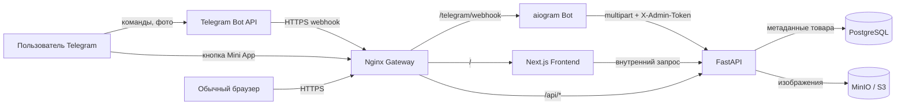
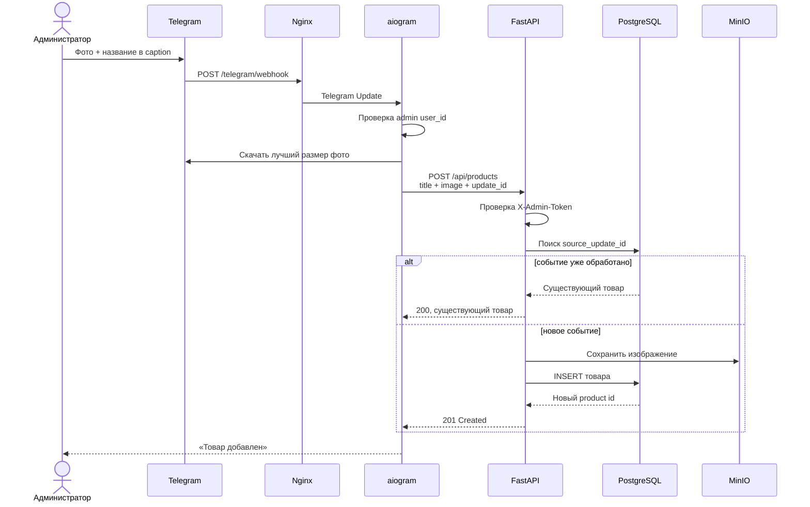
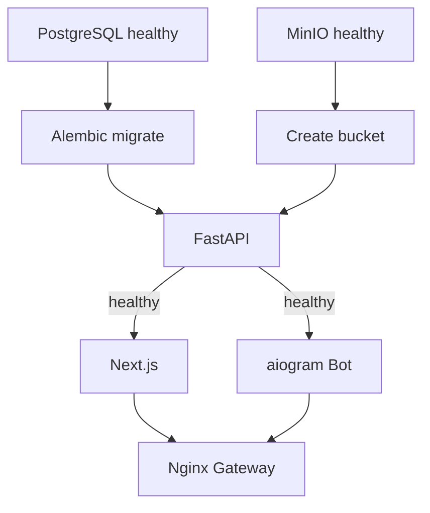

# Catalog Service — подробное руководство по проекту

Этот документ объясняет проект не только на уровне «что запустить», но и на уровне «почему он устроен именно так». Его удобно читать последовательно, а затем использовать как шпаргалку при самостоятельной переработке решения.

## 1. Что делает проект

Проект реализует минимальный каталог товаров со следующим сценарием:

1. Администратор открывает Telegram-бота.
2. Нажимает «Создать товар».
3. Отправляет фотографию товара и его название в подписи к фотографии.
4. Бот скачивает фотографию из Telegram и передаёт её в FastAPI.
5. FastAPI сохраняет метаданные товара в PostgreSQL, а изображение — в S3-совместимое объектное хранилище.
6. Next.js запрашивает товары у FastAPI и показывает каталог.
7. Каталог можно открыть в обычном браузере или внутри Telegram как Mini App.

В проекте нет оплаты, корзины, сложной административной панели и дизайна. Это осознанный MVP, демонстрирующий архитектуру и интеграцию технологий.

## 2. Общая архитектура



### Кто за что отвечает

| Компонент | Технология | Ответственность |
|---|---|---|
| `frontend` | Next.js App Router | Отображение списка товаров в браузере и Telegram Mini App |
| `api` | FastAPI | Бизнес-логика, валидация, работа с БД и изображениями |
| `bot` | aiogram 3 | Приём Telegram-событий и административный сценарий создания товара |
| `postgres` | PostgreSQL | Надёжное хранение метаданных товаров |
| `minio` | S3-совместимое хранилище | Хранение бинарных файлов изображений |
| `gateway` | Nginx | Единая точка входа, маршрутизация и балансировка реплик |
| `migrate` | Alembic | Применение миграций базы данных до запуска API |
| `minio-init` | MinIO Client | Создание bucket при первом запуске |

## 3. Структура каталогов

```text
catalog-service/
├── backend/
│   ├── alembic/                 # миграции PostgreSQL
│   ├── app/
│   │   ├── api/products.py      # endpoints товаров
│   │   ├── config.py            # настройки FastAPI
│   │   ├── database.py          # async engine и сессии SQLAlchemy
│   │   ├── dependencies.py      # проверка X-Admin-Token
│   │   ├── main.py              # создание FastAPI-приложения
│   │   ├── models.py            # SQLAlchemy-модель Product
│   │   ├── schemas.py           # Pydantic-схемы ответа
│   │   └── storage.py           # адаптер объектного хранилища
│   ├── tests/                   # тесты API
│   ├── Dockerfile
│   └── requirements.txt
├── bot/
│   ├── app/
│   │   ├── config.py            # настройки Telegram-бота
│   │   ├── handlers.py          # обработчики команд и фотографий
│   │   └── main.py              # aiohttp webhook-приложение
│   ├── tests/                   # тесты бота
│   ├── Dockerfile
│   └── requirements.txt
├── frontend/
│   ├── app/
│   │   ├── layout.tsx           # общий layout
│   │   ├── page.tsx             # серверная страница каталога
│   │   └── styles.css           # минимальные стили
│   ├── components/
│   │   └── telegram-bridge.tsx  # подключение Telegram WebApp SDK
│   ├── Dockerfile
│   └── package.json
├── gateway/
│   └── nginx.conf               # маршрутизация запросов
├── compose.yaml                 # описание всего локального стека
├── .env.example                 # пример переменных окружения
└── README.md                    # краткая инструкция запуска
```

## 4. Как проходит добавление товара



### Почему название и фотография приходят одним сообщением

Telegram передаёт подпись изображения в поле `caption`. Благодаря этому боту не требуется хранить промежуточное состояние диалога: он сразу получает все данные для создания товара.

Это важно для stateless-архитектуры. Любая реплика бота может обработать событие без знания о предыдущих сообщениях.

## 5. Frontend: Next.js App Router

### Основная идея

Файл `frontend/app/page.tsx` является серверным компонентом. Он выполняется на сервере Next.js, запрашивает товары у внутреннего API и возвращает готовую HTML-разметку.

```ts
const response = await fetch(`${apiUrl}/api/products`, { cache: "no-store" });
```

`cache: "no-store"` означает, что Next.js не должен отдавать старую сохранённую копию каталога. После добавления товара обновление страницы приводит к новому запросу в FastAPI.

### Почему используется `INTERNAL_API_URL`

В Docker-сети frontend обращается к API по адресу:

```text
http://api:8000
```

`api` — это имя сервиса в Docker Compose. Такой запрос не выходит в интернет и не зависит от публичного домена.

### Telegram Mini App

Компонент `telegram-bridge.tsx` загружает официальный Telegram WebApp SDK и вызывает:

```ts
Telegram.WebApp.ready();
Telegram.WebApp.expand();
```

- `ready()` сообщает Telegram, что приложение готово к показу;
- `expand()` раскрывает Mini App на доступную высоту.

Сам каталог остаётся обычным веб-сайтом. Telegram Mini App — это тот же HTTPS-сайт, открытый во встроенном WebView Telegram.

### Что можно улучшить во frontend

- добавить отдельную карточку товара;
- добавить skeleton/loading UI;
- добавить пагинацию;
- использовать компонент `next/image` и настроенные remote patterns;
- добавить обработку ошибок через `error.tsx`;
- добавить автоматическую инвалидацию кэша, если в будущем будет включено кэширование.

## 6. Backend: FastAPI

### Endpoints

| Метод | URL | Назначение | Защита |
|---|---|---|---|
| `GET` | `/health` | Проверка процесса API | Нет |
| `GET` | `/api/products` | Получить активные товары | Нет |
| `POST` | `/api/products` | Создать товар | `X-Admin-Token` |
| `GET` | `/api/products/{id}/image` | Получить изображение | Нет |

### Асинхронная сессия SQLAlchemy

В `database.py` создаётся async engine:

```python
engine = create_async_engine(settings.database_url, pool_pre_ping=True)
SessionFactory = async_sessionmaker(engine, expire_on_commit=False)
```

- `asyncpg` выполняет асинхронное общение с PostgreSQL;
- `pool_pre_ping=True` проверяет соединение перед использованием;
- `expire_on_commit=False` позволяет читать поля объекта после `commit` без нового запроса.

FastAPI получает сессию через dependency `get_session()`. Контекстный менеджер гарантирует закрытие сессии, а при исключении выполняется `rollback()`.

### Создание товара

Endpoint получает `multipart/form-data`:

- `title` — название;
- `source_update_id` — идентификатор Telegram Update;
- `image` — бинарный файл.

Проверки:

- название не может быть пустым;
- длина названия ограничена 255 символами;
- MIME type должен начинаться с `image/`;
- размер изображения ограничен 10 МБ;
- административный токен сравнивается через `secrets.compare_digest`.

### Транзакция и компенсация

Последовательность создания товара:

1. Изображение записывается в объектное хранилище.
2. В PostgreSQL создаётся запись.
3. Выполняется `commit()`.
4. Если запись в БД завершается неожиданной ошибкой, выполняются `rollback()` и удаление загруженного объекта.

Это упрощённая компенсационная транзакция между двумя независимыми системами: PostgreSQL и S3 не могут участвовать в одной обычной SQL-транзакции.

### Получение изображения

API не раскрывает внутренний MinIO напрямую. Оно читает объект и отдаёт его потоковыми блоками по 64 КБ через `StreamingResponse`.

Это позволяет:

- скрыть внутренний адрес хранилища;
- централизованно проверить наличие товара;
- не загружать весь файл повторно в память при выдаче;
- управлять HTTP-заголовками и кэшированием.

## 7. Модель данных PostgreSQL

Таблица `products` содержит:

| Поле | Тип | Назначение |
|---|---|---|
| `id` | `BIGINT IDENTITY` | Первичный ключ |
| `title` | `VARCHAR(255)` | Название товара |
| `image_object_key` | `VARCHAR(512)` | Ключ объекта в S3 |
| `image_content_type` | `VARCHAR(100)` | MIME type изображения |
| `source_update_id` | `BIGINT UNIQUE` | Защита от повторной обработки Telegram Update |
| `is_active` | `BOOLEAN` | Признак отображения товара |
| `created_at` | `TIMESTAMPTZ` | Время создания |

Частичный индекс:

```sql
CREATE INDEX ix_products_active_created
ON products (created_at DESC, id DESC)
WHERE is_active = true;
```

Он соответствует основному запросу каталога: показать только активные товары, начиная с новых.

### Зачем нужен `source_update_id`

Telegram может повторно доставить одно и то же событие, например после сетевого таймаута. Если две реплики одновременно получат один Update, обе попытаются создать товар.

Уникальное ограничение на `source_update_id` делает операцию идемпотентной:

- первый запрос создаёт товар;
- повторный запрос возвращает уже существующий товар;
- дубликат в БД не появляется.

## 8. Объектное хранилище MinIO / S3

Изображения не хранятся в PostgreSQL. База содержит только ключ объекта.

Пример ключа:

```text
products/telegram-update-654275988
```

Ключ детерминированный: один Telegram Update всегда соответствует одному объекту. Это дополнительно упрощает повторную обработку.

Python SDK MinIO является синхронным. Чтобы не блокировать event loop FastAPI, операции SDK запускаются через:

```python
await anyio.to_thread.run_sync(...)
```

В Docker Compose используется поддерживаемый S3-совместимый community-образ из семейства Silo, поскольку прежние публичные образы MinIO недоступны. Для приложения это прозрачно: используется тот же S3/MinIO API.

## 9. Telegram-бот на aiogram 3

### Webhook вместо polling

Telegram отправляет события HTTP POST-запросами на:

```text
https://public-domain/telegram/webhook
```

Преимущества webhook:

- нет постоянного цикла опроса Telegram;
- проще запускать несколько реплик за load balancer;
- Telegram доставляет каждый Update на один HTTP endpoint;
- приложение быстрее реагирует на входящие сообщения.

### Проверка подлинности webhook

При регистрации webhook задаётся `TELEGRAM_WEBHOOK_SECRET`. Telegram передаёт его в специальном заголовке, а `SimpleRequestHandler` проверяет значение.

Случайный запрос постороннего клиента без правильного секрета получает `401`.

### Администраторы

`TELEGRAM_ADMIN_IDS` содержит цифровые user ID через запятую:

```env
TELEGRAM_ADMIN_IDS=123456789,987654321
```

Кнопка «Создать товар» показывается только пользователям из этого списка. Серверная проверка выполняется повторно в каждом административном handler.

### Запуск нескольких реплик

При старте бот сначала читает текущий webhook через `getWebhookInfo`. Если правильный URL уже зарегистрирован, новый запрос `setWebhook` не выполняется.

Это предотвращает гонку и Telegram flood control при одновременном запуске нескольких реплик. Если Telegram всё же отвечает `RetryAfter`, бот ждёт указанное время и проверяет результат повторно.

## 10. Nginx Gateway

Gateway предоставляет единый внешний origin:

```text
https://example.com/
https://example.com/api/products
https://example.com/telegram/webhook
```

Маршрутизация:

| Путь | Сервис |
|---|---|
| `/` | `frontend:3000` |
| `/api/*` | `api:8000` |
| `/telegram/webhook` | `bot:8080` |

Nginx использует встроенный Docker DNS resolver `127.0.0.11`. При нескольких репликах Docker DNS возвращает адреса контейнеров, а gateway не привязан к конкретному экземпляру.

Локально также сохранены отдельные порты:

- `3000` — каталог и единый gateway;
- `8000` — API/Swagger;
- `8081` — прямой gateway к webhook;
- `9000` — S3 API;
- `9001` — консоль хранилища.

## 11. Docker и Docker Compose

### Multi-stage Dockerfile

Каждое приложение собирается в несколько этапов.

Python:

1. Builder скачивает зависимости и создаёт wheels.
2. Runtime устанавливает готовые wheels.
3. Исходники копируются в минимальный runtime-образ.

Next.js:

1. `dependencies` выполняет `npm ci`.
2. `builder` выполняет production build.
3. `runtime` получает только standalone-сборку и статические файлы.

Это уменьшает размер итоговых образов и не переносит в production лишние инструменты сборки.

### Non-root

Backend, bot и frontend запускаются от пользователей с UID `10001`, а не от `root`.

Если злоумышленник получит выполнение кода внутри приложения, non-root ограничит его возможности внутри контейнера.

### Healthchecks и порядок старта



Compose не запускает API до успешной миграции и создания bucket. Frontend и bot ожидают healthy API.

### Volumes

Используются два именованных volume:

- `postgres_data` — данные PostgreSQL;
- `minio_data` — изображения.

Контейнер можно удалить и создать заново, а данные сохранятся в volume.

## 12. Stateless и отказоустойчивость

Stateless здесь означает:

- приложение не хранит пользовательские сессии в памяти процесса;
- бот не хранит FSM-состояние диалога;
- файлы не сохраняются на локальный диск API или bot;
- метаданные находятся в PostgreSQL;
- изображения находятся в S3;
- конфигурация передаётся через environment variables.

Поэтому можно запустить несколько экземпляров:

```bash
docker compose up -d --scale api=2 --scale frontend=2 --scale bot=2
```

Что произойдёт при отказе одной реплики:

- Docker перезапустит контейнер благодаря `restart: unless-stopped`;
- Nginx продолжит отправлять запросы оставшимся экземплярам;
- данные не потеряются, потому что находятся вне процессов приложений.

Важно: в реальном production PostgreSQL и S3 тоже должны быть отказоустойчивыми внешними сервисами или кластерами. Один локальный контейнер PostgreSQL остаётся единой точкой отказа.

## 13. Переменные окружения

| Переменная | Кому нужна | Назначение |
|---|---|---|
| `POSTGRES_DB` | PostgreSQL, API | Имя базы |
| `POSTGRES_USER` | PostgreSQL, API | Пользователь БД |
| `POSTGRES_PASSWORD` | PostgreSQL, API | Пароль БД |
| `MINIO_ROOT_USER` | MinIO, API | Access key |
| `MINIO_ROOT_PASSWORD` | MinIO, API | Secret key |
| `MINIO_BUCKET` | MinIO init, API | Bucket изображений |
| `ADMIN_API_TOKEN` | Bot, API | Секрет внутреннего POST endpoint |
| `TELEGRAM_BOT_TOKEN` | Bot | Токен от BotFather |
| `TELEGRAM_ADMIN_IDS` | Bot | Разрешённые администраторы |
| `TELEGRAM_WEBHOOK_URL` | Bot | Публичный HTTPS webhook |
| `TELEGRAM_WEBHOOK_SECRET` | Bot | Проверка запросов Telegram |
| `WEB_APP_URL` | Bot, API | Публичный URL Mini App и CORS origin |
| `PUBLIC_API_URL` | API | Публичная основа URL изображений |

### Правила безопасности

- не коммитить `.env`;
- заменить `change-me` и `change-me-too` случайными значениями;
- использовать отдельные секреты для разных окружений;
- не публиковать Telegram token в сообщениях и логах;
- при утечке токена отозвать его через BotFather;
- production-секреты хранить в secret manager платформы.

## 14. Локальный запуск

### Шаг 1. Создать `.env`

```bash
cp .env.example .env
```

На Windows файл можно скопировать вручную.

### Шаг 2. Заполнить обязательные значения

```env
TELEGRAM_BOT_TOKEN=<token from BotFather>
TELEGRAM_ADMIN_IDS=<your numeric Telegram user id>
ADMIN_API_TOKEN=<random secret>
TELEGRAM_WEBHOOK_SECRET=<random secret>
```

Для Telegram webhook и Mini App также требуются публичные HTTPS URL.

### Шаг 3. Запустить стек

```bash
docker compose up --build -d
```

### Шаг 4. Проверить

```bash
docker compose ps
docker compose logs -f api
docker compose logs -f bot
```

Открыть:

- <http://localhost:3000> — каталог;
- <http://localhost:8000/docs> — Swagger;
- <http://localhost:9001> — S3 console.

### Шаг 5. Остановить

```bash
docker compose down
```

Команда не удаляет volumes. Для намеренного удаления локальных данных используется `docker compose down -v`, но применять её следует осторожно.

## 15. Тесты и проверки

Backend:

```bash
cd backend
python -m pytest -q
```

Bot:

```bash
cd bot
python -m pytest -q
```

Frontend:

```bash
cd frontend
npm ci
npm run typecheck
npm run build
```

Compose:

```bash
docker compose config --quiet
```

Проверка нескольких реплик:

```bash
docker compose up -d --scale api=2 --scale frontend=2 --scale bot=2
docker compose ps
```

## 16. Как самостоятельно разобрать проект по шагам

Рекомендуемый порядок изучения:

### Этап 1. Данные

1. Откройте миграцию `backend/alembic/versions/...create_products.py`.
2. Сопоставьте SQL-поля с `backend/app/models.py`.
3. Найдите уникальный `source_update_id` и индекс активных товаров.
4. Выполните запрос к `/api/products` через Swagger.

### Этап 2. FastAPI

1. Начните с `backend/app/main.py`.
2. Перейдите в `api/products.py`.
3. Проследите `POST /api/products` сверху вниз.
4. Посмотрите, откуда приходит `AsyncSession`.
5. Проследите загрузку и чтение изображения через `storage.py`.

### Этап 3. Telegram

1. Начните с `bot/app/main.py` и регистрации webhook.
2. Перейдите к `handlers.py`.
3. Проследите `/start` и формирование клавиатуры.
4. Проследите обработчик `F.photo`.
5. Найдите проверку администратора и передачу `update_id`.

### Этап 4. Frontend

1. Откройте `frontend/app/page.tsx`.
2. Найдите server-side запрос к API.
3. Посмотрите три состояния: ошибка, пустой список, список товаров.
4. Откройте `telegram-bridge.tsx` и разберите подключение WebApp SDK.

### Этап 5. Инфраструктура

1. Проследите зависимости сервисов в `compose.yaml`.
2. Сопоставьте имена сервисов с внутренними URL.
3. Разберите маршруты `gateway/nginx.conf`.
4. Запустите одну реплику, затем две и сравните `docker compose ps`.
5. Остановите одну реплику и убедитесь, что публичный запрос продолжает работать.

## 17. Что стоит переработать следующим этапом

### Приоритет 1 — production-безопасность

- постоянный домен вместо временного tunnel URL;
- HTTPS через ingress или reverse proxy;
- secret manager;
- ограничение частоты запросов;
- отдельные MinIO access keys вместо root credentials;
- проверка содержимого изображения, а не только MIME type;
- лимиты тела запроса в Nginx.

### Приоритет 2 — функциональность

- цена и описание товара;
- категории;
- редактирование и деактивация товара;
- пагинация;
- карточка товара;
- корзина и заказ;
- административный интерфейс.

### Приоритет 3 — наблюдаемость

- структурированные JSON-логи;
- request/correlation ID;
- Prometheus metrics;
- tracing;
- readiness и liveness probes отдельно;
- централизованный сбор ошибок.

### Приоритет 4 — тестирование

- интеграционные тесты с временными PostgreSQL и S3;
- тест обработки повторного Telegram Update;
- тест компенсационного удаления S3-объекта;
- end-to-end тест через браузер;
- CI pipeline для тестов и сборки Docker-образов.

## 18. Краткая модель проекта в голове

Если свести архитектуру к одной фразе:

> Telegram-бот является административным клиентом FastAPI, Next.js является публичным клиентом FastAPI, PostgreSQL хранит структуру данных, S3 хранит файлы, а Nginx объединяет всё под одним адресом.

Основные архитектурные идеи проекта:

1. Процессы приложений не владеют постоянным состоянием.
2. Повторная доставка событий безопасна.
3. Бинарные файлы отделены от реляционных данных.
4. Внешний трафик проходит через единую точку входа.
5. Миграции и инициализация хранилища отделены от runtime-приложений.
6. Все компоненты собираются и запускаются воспроизводимо через Docker.
